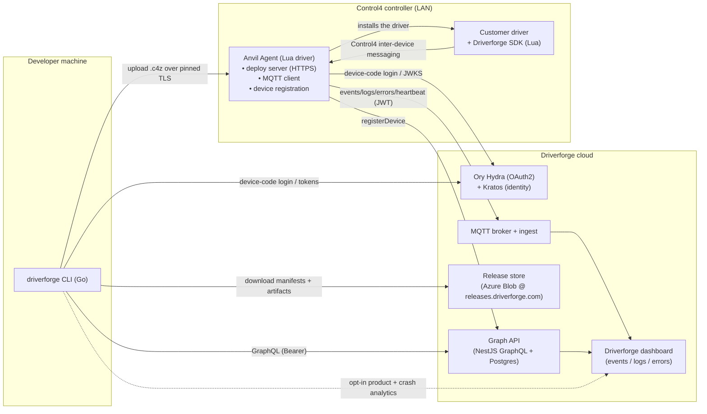
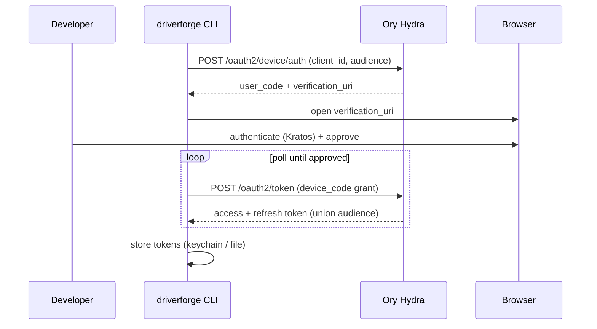
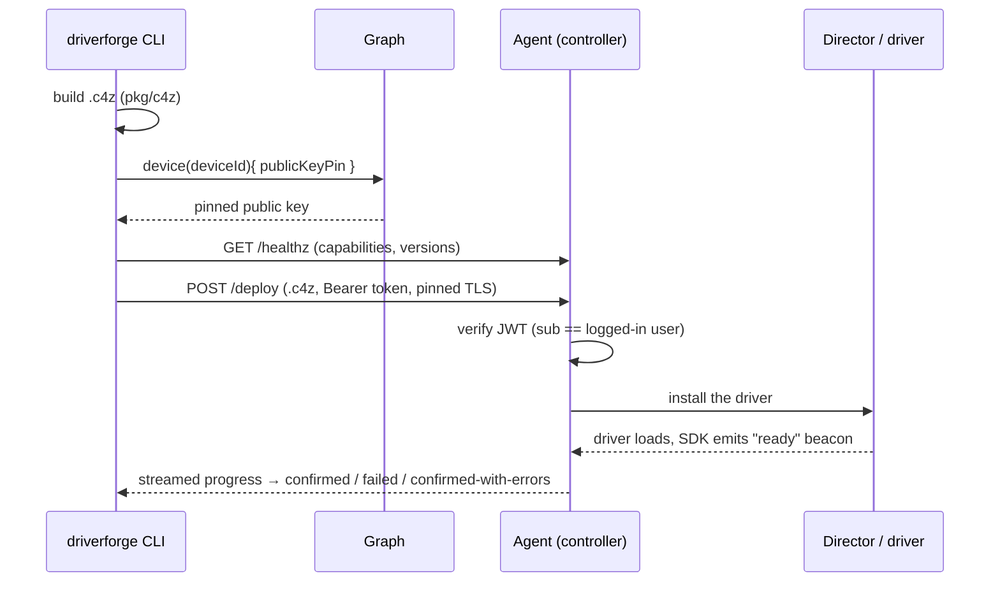
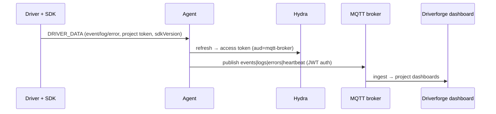
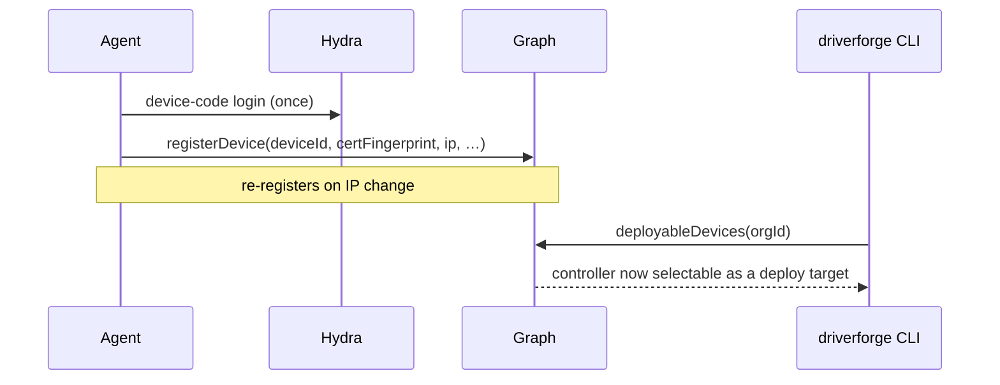

# Driverforge — Architecture & Technical Overview

> Driverforge's developer platform for **building, deploying, and observing Control4 drivers**.
> This document explains how the four moving parts — the **CLI**, the on-controller **Agent**,
> the in-driver **SDK**, and the **Graph backend** — hang together, and where the **identity
> provider (IDP)** plugs in.

---

## 1. The big picture

Driverforge turns Control4 driver development — historically a manual, opaque, "copy the .c4z into Composer
and hope" workflow — into a modern toolchain: a CLI that builds and deploys, an on-controller agent
that installs drivers and streams live telemetry, and an SDK that instruments a driver so its events,
logs, and errors show up in a dashboard.

| Component | Language / Runtime | Where it runs | Responsibility |
|---|---|---|---|
| **driverforge CLI** | Go (Cobra) | Developer's machine | Build `.c4z`, deploy/sync, `init` (retrofit), auth, project/device management |
| **Driverforge SDK** | Lua 5.1 | Inside each driver, in the Control4 sandbox | Instruments driver event handlers; captures events / logs / errors |
| **Anvil Agent** | Lua 5.1 | On the Control4 controller (a driver itself) | Receives uploads + installs drivers; registers the controller; forwards telemetry |
| **Graph backend** | NestJS GraphQL + Prisma/Postgres | Cloud | Source of truth: orgs, projects, devices, entitlements/billing |
| **IDP (Ory)** | Hydra (OAuth2) + Kratos (identity) | Cloud | Issues/validates tokens for CLI and Agent; publishes JWKS |
| **Release store** | Azure Blob (`releases.driverforge.com`) | Cloud/CDN | Versioned, manifest-driven distribution of CLI, Agent, and SDK |
| **Telemetry sinks** | MQTT broker + ingest, Sentry, Mixpanel, Grafana | Cloud | Driver/agent telemetry (MQTT); CLI product/crash analytics (opt-in) |

### System context



---

## 2. The CLI (`driverforge`)

A single Go binary (Cobra command tree under `internal/cli`, domain logic in `internal/*` and
`pkg/c4z`). It is treated as an **untrusted, distributed public client** — it never holds a client
secret.

**Command surface (today):**

- **Project lifecycle:** `init` (retrofit an existing driver for Driverforge), `build`, `deploy`, `sync`, `publish` *(planned)*
- **Identity:** `login`, `logout`, `whoami`
- **Context:** `org` (list/select/show), `device` (list/select/scan)
- **Operations:** `upgrade` (interactive update picker: CLI, agent, SDK), `version`

**Build pipeline (`pkg/c4z`)** — turns a driver source tree into a `.c4z`:

```
manifest.c4zproj ─┐
driver.xml ───────┤
src/*.lua ────────┼─▶ resolve ▶ version ▶ squish (bundle Lua) ▶ driver.xml transform
squishy ──────────┘                       ▶ encrypt (optional) ▶ pack (.c4z zip) ▶ sourcemap
```

**Deploy vs sync** (both build the driver first, so what ships always matches the current source):
- **`deploy`** — build + full install + driver reload on the controller (used for structural changes). Auto-bumps `<version>` per the project's versioning scheme (`date` YYYYMMDDNN or `integer`, chosen at `driverforge init`) — Director only reloads a higher version.
- **`sync`** — build + fast Lua **hot-swap** of the running driver (no reload, no version bump), gated on a structural hash so it falls back to a full deploy when `driver.xml` changed.

**Local state** (under the OS config dir, e.g. macOS `~/Library/Application Support/driverforge/`):
- `credentials.json` *(or OS keychain)* — tokens
- `context.json` — selected org + device (host/IP + the agent's pinned public key, cached for reachability)
- `config.json` — anonymous id + telemetry consent
- `sdk/<version>/driverforge-sdk.lua` — cached SDK bundles (local-first; see §6)

**CLI self-telemetry (opt-in, best-effort, never blocks a command):**
- **Sentry** — crash reporting. **Rule:** anticipated, user-facing conditions are modelled as
  `clierr.UserError` and are **never** reported; only unexpected errors are.
- **Mixpanel** (product events) and **Grafana Cloud / OTLP** (technical metrics) — consent-gated;
  disabled by `DRIVERFORGE_NO_METRICS`, `DO_NOT_TRACK`, or `CI`.

---

## 3. The SDK (in-driver, Lua)

The SDK is a single squished file (`driverforge-sdk.lua`, built from `harness.lua` + `anvil.lua` +
`queue.lua` + `stacktrace.lua` + `version.lua`) that `driverforge init` embeds into a driver's
`src/vendor/`. It is **versioned** (`SDK_VERSION`) and that version is stamped on every payload so
fleet adoption is trackable.

**Public API (what a driver author touches):**

```lua
require('vendor.driverforge-sdk')
Driverforge:Init(projectToken, { logger = Log })               -- the project's `drv_` token
Anvil:OnDriverInit(function(strDIR) … end, strDIR)            -- defer instrumented init
-- also: Anvil:SetTimer(...), Anvil:CaptureError(...)
```

**What it does at runtime:**
- **Auto-instruments** every Control4 event handler (`ExecuteCommand`, `OnPropertyChanged`,
  `OnDriverLateInit`, …): captures a trace/span id, timing, args, result, and success/failure.
- **Forwards logs** from the driver's existing logger (no logger is bundled — the driver supplies
  one or gets no forwarding).
- **Captures errors** with full stack traces (shared `stacktrace.lua` format with the Agent, so the
  dashboard render is transport-blind).
- **Queues** telemetry until the Agent is discovered, then drains.
- **Redacts** sensitive handlers (e.g. private-key password) before they leave the device.

**Transport to the Agent:** Control4 **inter-device messaging** (`C4:SendToDevice`) with a
`DRIVER_DATA` command carrying a JSON envelope `{ eventType, projectToken, sdkVersion, payload }`. The SDK
discovers the Agent by its driver filename. It also emits a `ready` **lifecycle beacon** at the end
of `OnDriverLateInit` — that's how a deploy is confirmed (see §7).

> `driverforge init` performs this integration automatically: embeds the SDK, wraps the driver's
> `OnDriverInit`, registers the `vendor/` dir in the manifest, and records the integration in a
> committed `.driverforge/config.json` — all shown as an approved diff first.

---

## 4. The Agent (on-controller, Lua)

The Agent is itself a Control4 driver, installed once per controller. It is the controller's
representative in the Driverforge system, and the local endpoint the CLI talks to.

Only that endpoint is covered here. The Agent also carries the controller's own telemetry, heartbeat
and self-reporting, none of which the CLI is involved in.

Three things matter from the CLI's side: the Agent accepts an uploaded `.c4z` and installs it into
the Director, it confirms afterwards whether the driver actually came back up (by correlating the
SDK's `ready` beacon to the deploy waiting on it), and it registers the controller with the Graph so
that it appears as a deployable target at all.

**Deploy server (the CLI's local endpoint)** — a network ingress for *remote code execution* on the
controller, so it is locked down:
- **HTTPS** with a certificate the Graph issues for the controller's key; the CLI **pins the
  public key** (SHA-256 of its SubjectPublicKeyInfo) it fetched from the Graph, not the
  certificate, so the frequent certificate reissues don't change the pin.
- Every `/deploy` / `/sync` request carries a **bearer OAuth token**; the Agent verifies it (JWKS,
  RS256) and requires the token's `sub` to **match the Agent's own logged-in user**.
- A Composer **"Deploy Server" off** kill-switch disables the ingress entirely.
- `GET /healthz` (unauthenticated) advertises agent/controller version, MAC, protocol version, and
  capabilities (`deploy`, `sync`, `driver-state`, `deploy-stream`, `bootstrap`). The CLI uses this
  for capability negotiation and version reporting.

---

## 5. The Graph backend & data model

A GraphQL API at `https://graph.driverforge.com/graphql` — the **source of truth** for
organizations, projects and devices. Everything the CLI needs to answer "which project am
I linked to, and which controller am I deploying at" comes from here.

The shape the CLI navigates is `Organization` → `Project` → `ApiKey`, plus `Device` for controllers.
Entitlements gate project creation during `init`.

**Operations the CLI uses:**

| Operation | Type | Used by |
|---|---|---|
| `myOrganizations` | query | `org list/select`, `init` |
| `myProjects` | query | `init` (project picker; carries each project's token) |
| `createProject` | mutation | `init` (create-new flow; returns the new project's token) — entitlement-gated (`canCreateProject`) |
| `deployableDevices(organizationId)` | query | `device list/select`, deploy targeting |
| `device(deviceId){ publicKeyPin }` | query | deploy/sync (pin the controller's TLS key) |

Controllers reach `deployableDevices` by registering themselves: the Agent publishes its identity
and key (as a certificate request) to the Graph, and re-registers on IP change so the CLI keeps targeting
the right host. Nothing in the CLI drives that — it only reads the result.

`init` writes the project's token into the driver, which is how its telemetry is attributed to the
project once it runs. The token comes back on the project itself, from `myProjects` or `createProject`,
so there is nothing to look up or provision separately.

The token **identifies**; it does not authorise. It grants no permissions, does not expire, cannot be
revoked, and is not secret — it is committed to the driver's repository and shipped inside the `.c4z`
by design. Its prefix varies by project kind (`drv_` for drivers, `agt_` for the agent), so treat the
prefix as a display detail rather than something to validate.

---

## 6. Distribution & versioning

All three artifacts ship from one manifest-driven store — clients never hard-code version lists.

```
https://releases.driverforge.com/driverforge-releases/
  driverforge-cli/   latest|v<ver>/manifest.json
  anvil-agent[-dev]/ latest|v<ver>/manifest.json + .c4z
  driverforge-sdk/   latest|v<ver>/manifest.json + driverforge-sdk-<ver>.zip
```

- **CLI** — a one-shot **update *notifier*** (not a self-updater) prints an upgrade hint on a 24h
  cadence (suppressed in CI / non-TTY / dev builds).
- **Agent** — the `driverforge upgrade` picker resolves the agent build keyed by its *installed filename*
  so an upgrade can't silently switch a controller's environment profile.
- **SDK** — `driverforge init` is **local-first**: it uses a cached `driverforge-sdk.lua` with no network call,
  and only fetches a manifest when you explicitly opt to download (latest, or a pinned `x.y.z`).
- Override the store with `DRIVERFORGE_RELEASES_BASE_URL`. Source mirrors are published to public GitHub
  (via Copybara) for transparency; **Azure is canonical**.

---

## 7. Identity & trust model (IDP touchpoints)

Identity is the spine of the system. **Ory Hydra** issues OAuth2 tokens; **Ory Kratos** holds the
user identities; **JWKS** (RS256) is the shared verification anchor.

### Who authenticates, how

| Principal | Flow | Audience(s) | Presents to |
|---|---|---|---|
| **Developer (CLI)** | OAuth2 **Device Authorization Grant** (RFC 8628) | `graph` (+ `anvil-agent` for deploy) | Graph API (Bearer); Agent deploy server (Bearer) |
| **Controller (Agent)** | OAuth2 **device-code**, refresh-based | `mqtt-broker`, `graph` (`device:register`) | MQTT broker (JWT as password); Graph `registerDevice` |
| **Driver (SDK)** | none (carries a project token, which identifies but does not authorise) | — | Agent, via inter-device messaging |

### Defense-in-depth highlights

- **Public client, no secret** — the CLI never holds/transmits a client secret; the user authorizes
  in their own browser and the CLI polls for the token.
- **Audience narrowing** — both CLI and Agent hold a broad refresh token but **mint per-call access
  tokens narrowed to exactly one audience** (e.g. an Agent's MQTT token can't be replayed against the
  Graph, and a deploy token can't call the Graph). Refresh tokens never travel on the wire as
  credentials.
- **JWT verification everywhere it matters** — the Agent's deploy server and the MQTT broker both
  verify RS256 JWTs against cached JWKS (forced refresh on validation failure).
- **Key pinning instead of PKI** — the controller's public key is published to the Graph at
  registration and pinned by the CLI for every upload. The key outlives every certificate issued
  for it.
- **Identity binding** — a deploy request's token `sub` must match the Agent's own logged-in user, so
  a stray token from elsewhere can't push code to the controller.

### Login (device authorization grant)



---

## 8. Key end-to-end flows

### Deploy a driver



### Live debug (`driverforge debug`, Remote4)

```mermaid
sequenceDiagram
  participant Dev as Developer's Lua process
  participant CLI as driverforge CLI
  participant B as Anvil MQTT broker
  participant S as Remote4 stub (on controller)
  participant D as Director

  CLI->>Dev: start runtime.lua, compile driver source
  CLI->>CLI: build .c4z, swap script for the stub bundle (driver.xml untouched)
  CLI->>B: connect (mqtt-broker JWT), subscribe remote4/{user}/{session}/+
  CLI->>S: POST /deploy via the agent (as for deploy)
  D->>S: OnDriverInit
  S->>B: connect (same user's JWT, baked in; refreshed over `control`)
  S-->>CLI: status online; queued callbacks flush
  CLI->>Dev: load driver (file-scope C4 calls now reach the controller)
  D->>S: ReceivedFromProxy(...)
  S-->>CLI: callback (fire-and-forget; stub returns nil to Director)
  CLI->>Dev: callback
  Dev->>CLI: c4_call SendToProxy(...)
  CLI->>S: c4_call
  S->>D: C4:SendToProxy(...)
  S-->>CLI: c4_response
  CLI->>Dev: c4_response (the only side that blocks)
```

The stub, the runtime and the wire contract live in the platform repo
(`remote4/`, `docs/remote4-protocol.md`) and are vendored into
`internal/remote4/assets` by `scripts/vendor-remote4.sh`. `internal/remote4`
holds the Go side: bundling, the broker client, the runtime process and the
bridge between them. Callbacks are one-way because a driver cannot block on
its own event loop; `C4` calls are synchronous from the local driver's point
of view because only the laptop waits.

### Runtime telemetry



### Controller onboarding (device registration)



---

## 9. Trust boundaries (at a glance)

| Boundary | What crosses it | How it's protected |
|---|---|---|
| CLI ↔ Hydra | login + token refresh | TLS; public client; device-code flow |
| CLI ↔ Graph | GraphQL operations | Bearer access token (`aud=graph`) |
| CLI ↔ Agent (LAN) | `.c4z` uploads (RCE-capable) | HTTPS + **pinned** self-signed cert; Bearer token bound to logged-in user; kill-switch |
| Agent ↔ Hydra | login + per-call tokens | TLS; **audience-narrowed** tokens; refresh token never sent as credential |
| Agent ↔ MQTT broker | telemetry | JWT (narrowed to `aud=mqtt-broker`); broker host **locked at build time** |
| Agent ↔ Graph | `registerDevice` | Bearer token (`aud=graph`, `scope=device:register`) |
| Driver/SDK ↔ Agent | telemetry + lifecycle | On-controller inter-device messaging; the project token attributes ingestion |

---

## 10. Configuration & environments

Everything is environment-overridable so the same binaries run against dev/staging/prod:

- **CLI:** `DRIVERFORGE_AUTH_URL`, `DRIVERFORGE_GRAPH_URL`, `DRIVERFORGE_RELEASES_BASE_URL`, `DRIVERFORGE_CREDENTIALS_BACKEND`
  (`keyring`/`file`/auto), telemetry toggles (`DRIVERFORGE_NO_METRICS`, `DO_NOT_TRACK`, `CI`). Release
  builds inject endpoints/version via `-ldflags`.
- **Agent:** build-time `.env.<profile>.lua` bakes the IDP (`HYDRA_URL`), broker (`MQTT_SERVER/PORT/
  TLS`), `GRAPH_URL`, and deploy-server settings. The MQTT broker host is **deliberately not
  runtime-overridable** (prevents a peer driver from redirecting the broker connection and
  exfiltrating the token).
- **SDK:** version baked at build; the embedded version is what a deployed driver reports for its
  lifetime (only a re-build + re-deploy updates it).

---

## 11. One-slide summary

- **CLI** builds and ships drivers; **SDK** instruments them; **Agent** installs them and streams
  what they do; **Graph** is the system of record; **Ory** is identity.
- **Identity is narrow by design:** public client, device-code login, per-call audience-scoped
  tokens, JWKS verification, cert pinning, and user-bound deploys.
- **Distribution is manifest-driven** from one release store, with local-first SDK caching.
- **Telemetry splits cleanly:** driver/agent runtime data over MQTT to the dashboard; CLI
  product/crash analytics are opt-in and never block a command.
